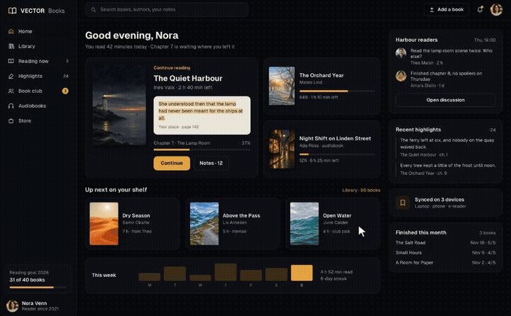

# Reader Size

**I made the text bigger and didn't lose my line.**



**Live demo:** [veraetogrex-portfolio.github.io/reader-size](https://veraetogrex-portfolio.github.io/reader-size/) · **Mockup:** [full-screen version](https://veraetogrex-portfolio.github.io/reader-size/mockup/reader-size.html)

A desktop reader screen: A+ makes the text really larger, the lines wrap again and the page count recounts, while the highlighted line and its ribbon stay at the same height of the page. Vanilla HTML/CSS/JS, zero dependencies.

## Try it

- Press Continue on "The Quiet Harbour". The reader opens on chapter 7, page 142 of 388, set at 18 px; the highlighted line "She understood then that the lamp had never been meant for the ships at all." sits next to the bookmark ribbon.
- Press Aa. The Display panel opens with the text size, about 10 words a line, and Keep my line in place switched on.
- Press A+. The text really grows to 22 px: the lines wrap again in 0.5 s, 8 words a line, the book becomes 578 pages and the chapter page numbers in the contents recount. The highlighted line and the ribbon stay at the same height of the page.
- Press A+ again: 26 px, 7 words a line, 811 pages, the line still in place. A+ goes up to 30 px and A− down to 14 px, each turns off at its end; Reset goes back to 18 px. Press A+ or A− several times mid-reflow — the last size wins.
- Keyboard: Tab to A+ or A− and press Enter.
- With reduced motion on, the text jumps to the new size at once.

## Use it

Three files and the cover photos, no build step, no dependencies:

```
index.html   markup
style.css    styles
script.js    logic
assets/      book covers and reader photos (generated, free to reuse with the code)
```

Download the repo and open `index.html`, or copy the files into your project. Set `data-assets` on `<section class="rb">` to the folder with your images.

## License

MIT
